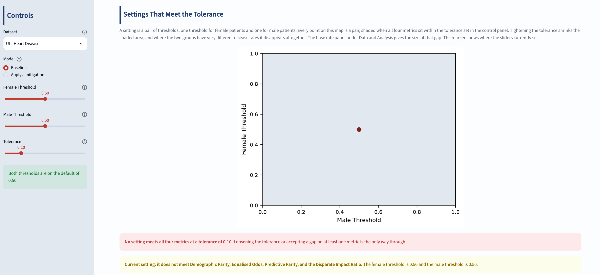
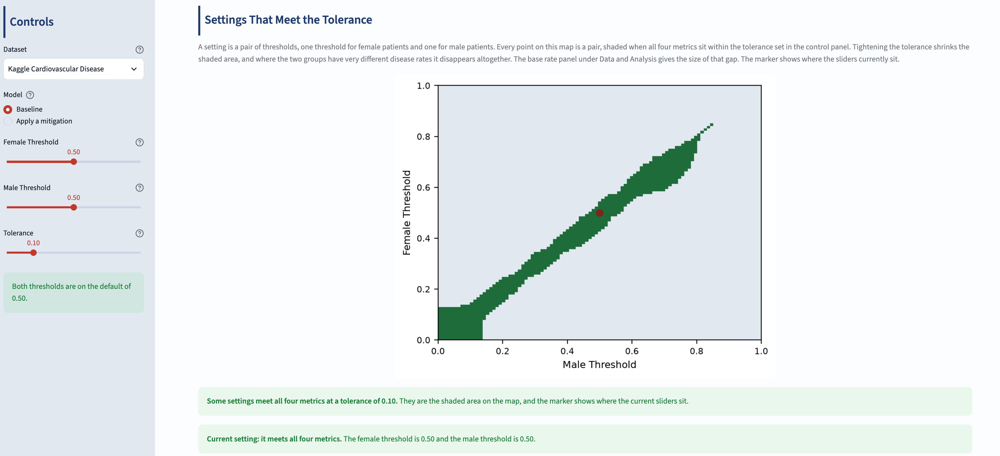
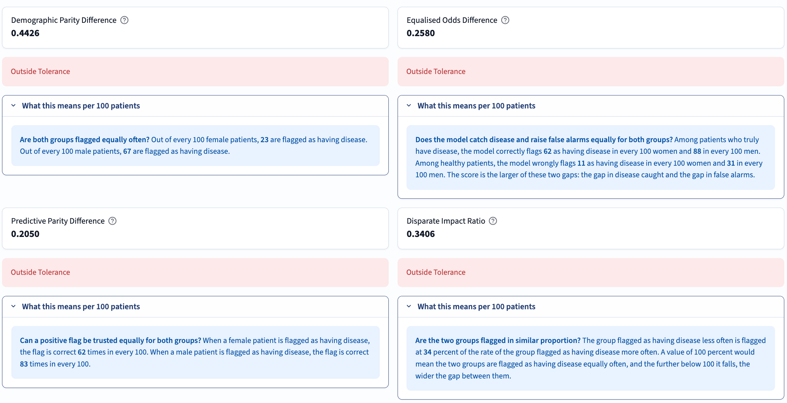
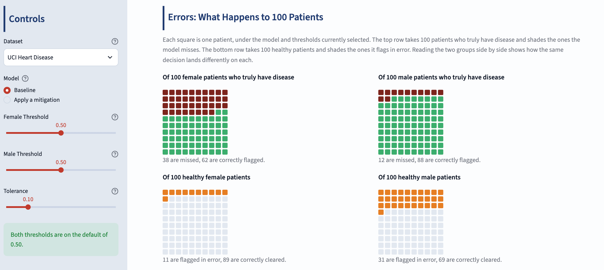
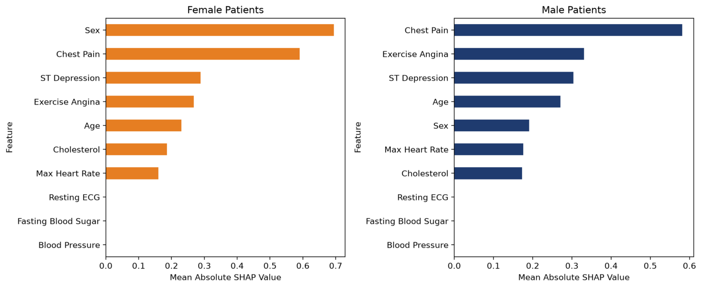
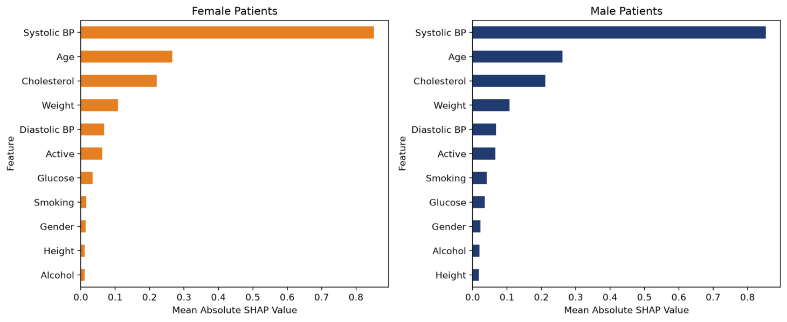
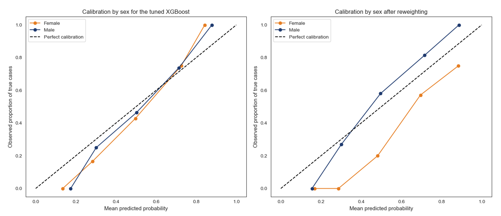
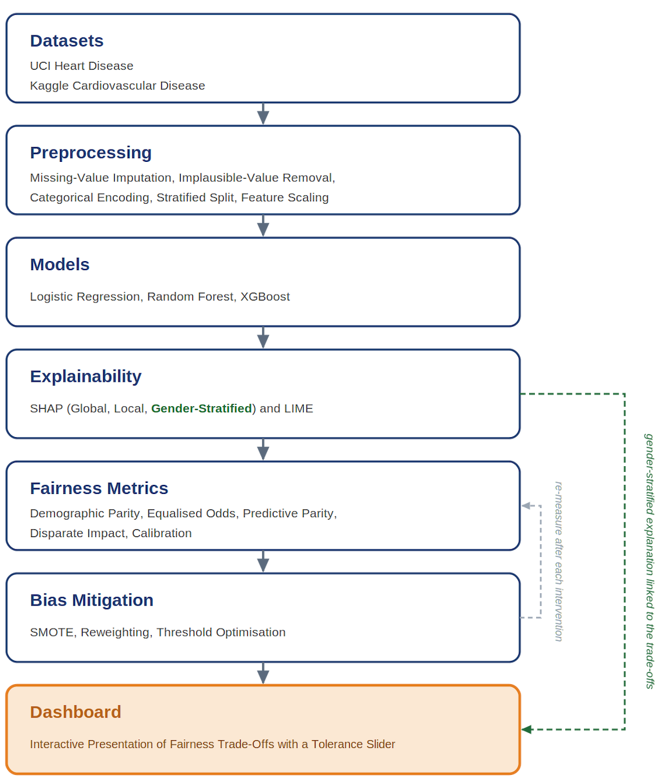

# Explainable and Fair Heart Disease Prediction

**Python | XGBoost, SHAP, LIME, Fairlearn, Streamlit | Two heart disease datasets | Interactive fairness trade-off dashboard**

I built this project to examine how a heart disease prediction model treats female and male patients. It has two aims: to investigate where a sex-based performance disparity enters the model, using SHAP explanations computed separately for each sex, and to develop an interactive dashboard that presents the fairness trade-offs the model faces. When the disease rate differs between two groups, no model can satisfy every fairness metric at once, so the dashboard does not pick a fair model. It lays out the trade-off and leaves the judgement to the user.

The same pipeline of three models, five fairness metrics and three mitigation methods is applied to two datasets with sharply contrasting base rates: a **37.45** percentage-point gap in disease rate between the sexes on the UCI Heart Disease data, and **0.75** on the Kaggle Cardiovascular Disease data. The contrast shows when the fairness constraints bind and when they do not.

**[Open the live dashboard](https://heart-disease-fairness-dashboard.streamlit.app)** · **[Read the full dissertation (PDF)](report/Explainable_Fair_Heart_Disease_Prediction_Report.pdf)**

This project is my MSc Computer Science dissertation, completed at Queen Mary University of London.

## Key findings

- **The base rates differ sharply on one dataset and hardly at all on the other.** On the UCI data, **63.22%** of male patients and **25.77%** of female patients have heart disease. On the Kaggle data the rates are **49.96%** and **49.21%**.
- **On the UCI data the model leans on sex for women but not for men.** Sex is the most important feature for female patients and drops to fifth place for male patients. The mean SHAP value for sex is **−0.6941** for women and **+0.1909** for men, so being female pushes the prediction towards no disease.
- **Real cases are missed more often in women.** The false negative rate of the tuned XGBoost is **0.3750** for female patients and **0.1170** for male patients: the model misses three in eight of the real cases in women against roughly one in nine in men.
- **All four decision-based metrics show substantial disparities on the UCI data.** The disparate impact ratio is **0.3406**, far below the 0.8 four-fifths threshold, so women are flagged as having disease at only about a third of the rate of men. The pattern holds for all three models (disparate impact **0.2129**, **0.4093** and **0.3406**).
- **Each mitigation narrows one disparity while widening another.** SMOTE-NC, reweighting and threshold optimisation all move demographic parity, equalised odds and disparate impact towards their fair values, but the predictive parity difference is higher under every method than the **0.2050** baseline, reaching **0.3316**. Reweighting also breaks the model's calibration for women.
- **On the Kaggle data the gaps and the reliance on sex all but vanish.** The disparate impact ratio is **0.9792**, the false negative rates are **0.3226** for women and **0.3203** for men, and gender ranks ninth of eleven features for both groups.
- **Being in the minority is not, on its own, a disadvantage.** Men are the minority on the Kaggle data (**34.9%** of patients), yet the model misses no larger share of their genuine cases. On the UCI data women are the minority and it does miss more of theirs. The disadvantage comes from the unequal error rates, not from the smaller number of patients.

## The dashboard

The dashboard is written for the person who trains a clinical prediction model and has to judge, before it reaches a clinician, whether its behaviour is acceptable. It does not choose a fair model for that person. The user sets a tolerance, the largest gap between the two groups they are willing to accept, and the dashboard reports whether the model can meet it.

**Settings that meet the tolerance.** The dashboard works through every pair of decision thresholds, one for female and one for male patients, from 0 to 1 in steps of 0.01 (10,201 pairs). It shades the pairs where all four decision-based metrics fall within the tolerance. This shaded set is the feasible region. At a tolerance of 0.10 the Kaggle region is broad, while the UCI region is empty and the dashboard states plainly that no setting meets all four metrics. Loosening the tolerance to 0.15 opens a narrow region on the UCI data, where both thresholds are high and the male threshold is higher than the female one.

<table>
  <tr>
    <td align="center"><a href="images/dashboard-feasible-region-uci.png"></a></td>
    <td align="center"><a href="images/dashboard-feasible-region-kaggle.png"></a></td>
  </tr>
  <tr>
    <td align="center">UCI data, tolerance 0.10: no setting meets all four metrics</td>
    <td align="center">Kaggle data, tolerance 0.10: a broad band of settings meets all four metrics</td>
  </tr>
</table>

**Metrics as values and as patients.** Each fairness metric is shown as a value against the tolerance and as a count of patients. On the UCI data, the demographic parity gap reads as 23 women flagged in every hundred against 67 men.

<p align="center"><a href="images/dashboard-fairness-metrics-uci.png"></a></p>

**Errors as 100 patients.** The errors behind the metrics are drawn as a hundred squares, one to a patient. Of 100 women who truly have disease 38 are missed, against 12 of 100 men. Among healthy patients the position reverses: 11 women are flagged in error against 31 men.

<p align="center"><a href="images/dashboard-errors-uci.png"></a></p>

**Controls and panels.**

| Area | What it holds |
| --- | --- |
| **Control panel** | Dataset (UCI or Kaggle), model (the baseline or one of the three mitigations), a female threshold, a male threshold and the tolerance |
| **Fairness Metrics and Errors** | The feasible region, the four fairness metrics against the tolerance, recall, precision and error rates by sex, the 100-patient view, and the individual missed cases and false alarms |
| **Data and Analysis** | Dataset overview and base rates, feature importance by sex (SHAP), calibration and ROC by sex, and a live comparison of every mitigation method on both datasets |

## Results

All results are calculated on the held-out test set at a decision threshold of 0.50.

### Model performance after tuning

| Dataset and model | Tuned settings | Training accuracy | Test accuracy | AUC-ROC |
| --- | --- | --- | --- | --- |
| UCI, Logistic Regression | C = 0.65 | 0.7853 | 0.7663 | 0.8772 |
| UCI, Random Forest | max_depth = 5, min_samples_leaf = 5 | 0.8546 | 0.7935 | 0.9033 |
| **UCI, XGBoost** | **max_depth = 1, learning_rate = 0.05, 150 trees** | **0.8152** | **0.8152** | **0.9082** |
| Kaggle, Logistic Regression | C = 1.00 | 0.7290 | 0.7212 | 0.7903 |
| Kaggle, Random Forest | max_depth = 14, min_samples_leaf = 5 | 0.7735 | 0.7294 | 0.7979 |
| **Kaggle, XGBoost** | **max_depth = 4, learning_rate = 0.05, 150 trees** | **0.7402** | **0.7288** | **0.7991** |

On the UCI data the two tree-based models overfitted at their default settings, reaching a training accuracy of 1.000, and tuning brought this under control. XGBoost was carried forward as the main model on both datasets.

### Fairness of the tuned XGBoost

| Fairness metric | UCI Heart Disease | Kaggle Cardiovascular Disease |
| --- | --- | --- |
| Demographic parity difference | 0.4426 | 0.0094 |
| Equalised odds difference | 0.2580 | 0.0024 |
| Predictive parity difference | 0.2050 | 0.0110 |
| Disparate impact ratio | 0.3406 | 0.9792 |
| False negative rate, female | 0.3750 | 0.3226 |
| False negative rate, male | 0.1170 | 0.3203 |

For the three difference metrics a value of 0 means the two groups are treated identically. For the disparate impact ratio a value of 1 means equal positive-prediction rates, and 0.8 is the four-fifths reference threshold.

### Feature importance by sex

<table>
  <tr>
    <td align="center"><a href="images/shap-by-sex-uci.png"></a></td>
  </tr>
  <tr>
    <td align="center">UCI data: sex leads the ranking for female patients and drops to fifth for male patients</td>
  </tr>
  <tr>
    <td align="center"><a href="images/shap-by-sex-kaggle.png"></a></td>
  </tr>
  <tr>
    <td align="center">Kaggle data: the two rankings are almost identical, with systolic blood pressure at the top and gender ninth of eleven for both groups</td>
  </tr>
</table>

This describes how the model uses sex, not a clinical cause of heart disease.

### Bias mitigation on the UCI data

The three methods were applied to the tuned XGBoost one at a time: oversampling the minority class with SMOTE-NC, reweighting so that sex and outcome become independent, and optimising a separate decision threshold for each sex.

| Metric | Baseline | SMOTE-NC | Reweighting | Threshold optimisation |
| --- | --- | --- | --- | --- |
| Demographic parity difference | 0.4426 | 0.3889 | 0.2460 | 0.1804 |
| Equalised odds difference | 0.2580 | 0.2048 | 0.0559 | 0.1596 |
| Predictive parity difference | 0.2050 | 0.2228 | 0.2985 | 0.3316 |
| Disparate impact ratio | 0.3406 | 0.3702 | 0.6016 | 0.7170 |
| Accuracy | 0.8152 | 0.8043 | 0.7880 | 0.7880 |
| Recall | 0.8627 | 0.8137 | 0.8235 | 0.8529 |

Every method narrows some of the gaps, but none closes them all, and predictive parity worsens under all three. The choice is not which model is correct but which metric to favour.

Reweighting carries a second cost. It gives female patients with disease the largest weight of the four groups (2.0935), which pushes the model towards flagging them but also changes what its probabilities mean. After reweighting, the model overestimates the risk of disease for women.

<p align="center"><a href="images/calibration-reweighting-uci.png"></a></p>

On the Kaggle data the same three methods have almost nothing to change: every metric stays close to fair, and accuracy is 0.7301 after SMOTE-NC, 0.7305 after reweighting and 0.7295 after threshold optimisation.

## How it works

<p align="center"><a href="images/pipeline.png"></a></p>

The same pipeline is applied to both datasets, so that their results can be compared on equal terms.

1. **Preprocessing.** On the UCI data, `ca`, `thal` and `slope` were dropped because they were missing for 66.41%, 52.83% and 33.59% of patients. Cholesterol readings of zero (172 patients) and one zero blood-pressure reading were treated as missing, numerical gaps were filled with the median and categorical gaps with the most frequent value. On the Kaggle data, 1,347 of the 70,000 rows were removed because a reading was physically impossible in a living adult, most of them (1,234) with a systolic reading below the diastolic one, and age was converted from days to years. Sex was encoded as 0 for women and 1 for men in both datasets.
2. **Split and scaling.** Each dataset was split 80/20 into training and test sets, stratified by the target, with a fixed random seed (`random_state = 42`). Features were scaled to a 0–1 range with a MinMaxScaler fitted on the training set only.
3. **Models.** Logistic Regression, Random Forest and XGBoost were tuned with 10-fold cross-validation on the training set.
4. **Explainability.** SHAP was used in three roles: a global ranking of features, a local explanation of single patients, and feature importance computed separately for female and male patients. LIME was used as a local cross-check, and the SHAP analysis was repeated on the tuned Random Forest.
5. **Fairness metrics.** Demographic parity, equalised odds, predictive parity and disparate impact were computed with Fairlearn from the model's decisions. Calibration was read from reliability curves for each sex.
6. **Bias mitigation.** SMOTE-NC, reweighting and Fairlearn's ThresholdOptimizer (equalised odds constraint, balanced accuracy objective) were applied to the tuned XGBoost, using the training data only.
7. **Dashboard.** Each notebook saves its predicted probabilities, gender-stratified SHAP values, calibration points and base rates to `dashboard_data/`, and the Streamlit app reads these files, so it does not need to retrain any model.

## Data

| Property | UCI Heart Disease | Kaggle Cardiovascular Disease |
| --- | --- | --- |
| Source | [UCI Heart Disease Data](https://www.kaggle.com/datasets/redwankarimsony/heart-disease-data) (Kaggle, Redwan Sony), from the UCI Machine Learning Repository | [Cardiovascular Disease dataset](https://www.kaggle.com/datasets/sulianova/cardiovascular-disease-dataset) (Kaggle, Svetlana Ulianova) |
| File | `heart_disease_uci.csv` | `cardio_train.csv` |
| Patients after preprocessing | 920, from four cardiology centres | 68,653, from 70,000 records |
| Features used | 10 | 11 |
| Female / male | 21.1% / 78.9% | 65.1% / 34.9% |
| Disease rate, female / male | 25.77% / 63.22% | 49.21% / 49.96% |
| Base-rate gap | 37.45 points | 0.75 points |

**Licences.** The UCI Heart Disease data is published in the [UCI Machine Learning Repository](https://archive.ics.uci.edu/dataset/45/heart-disease) under a Creative Commons Attribution 4.0 (CC BY 4.0) licence. Its creators are Andras Janosi (Hungarian Institute of Cardiology, Budapest), William Steinbrunn (University Hospital, Zurich), Matthias Pfisterer (University Hospital, Basel) and Robert Detrano (V.A. Medical Center, Long Beach and Cleveland Clinic Foundation). The Cardiovascular Disease dataset is listed on Kaggle with an unknown licence. Neither CSV file is included in this repository; both can be downloaded from the links above.

## Repository structure

```text
explainable-fair-heart-disease-prediction/
├── .github/
│   └── workflows/
│       └── keep-dashboard-awake.yml
├── .streamlit/
│   └── config.toml
├── dashboard_data/
│   ├── kaggle_*.csv
│   └── uci_*.csv
├── images/
│   ├── calibration-reweighting-uci.png
│   ├── dashboard-errors-uci.png
│   ├── dashboard-fairness-metrics-uci.png
│   ├── dashboard-feasible-region-kaggle.png
│   ├── dashboard-feasible-region-uci.png
│   ├── pipeline.png
│   ├── shap-by-sex-kaggle.png
│   └── shap-by-sex-uci.png
├── notebooks/
│   ├── cardio_kaggle.ipynb
│   └── heart_disease_uci.ipynb
├── report/
│   └── Explainable_Fair_Heart_Disease_Prediction_Report.pdf
├── README.md
├── app.py
└── requirements.txt
```

| File or folder | What it holds |
| --- | --- |
| `notebooks/` | The full analysis, one notebook per dataset, from loading and exploration to fairness and mitigation |
| `app.py` | The Streamlit dashboard |
| `dashboard_data/` | The 18 result files the dashboard reads: predicted probabilities, gender-stratified SHAP values, calibration points and base rates for each dataset |
| `.streamlit/config.toml` | The dashboard's theme settings |
| `.github/workflows/keep-dashboard-awake.yml` | A scheduled job that opens the live dashboard every six hours, so the hosted app does not go to sleep |
| `report/` | The full project report |

## How to run

The easiest option is the **[live dashboard](https://heart-disease-fairness-dashboard.streamlit.app)**, which opens in a browser.

**To run the dashboard locally**, from the repository root:

```bash
pip install -r requirements.txt
streamlit run app.py
```

The results the dashboard needs are already saved in `dashboard_data/`, so the notebooks do not have to be run first.

**To run the notebooks:**

1. Download `heart_disease_uci.csv` and `cardio_train.csv` from the two Kaggle links in the Data section.
2. Create a `data/` folder in the repository root and put both files in it. The notebooks read them from `../data/`.
3. Install Jupyter if needed (`pip install notebook`), open either notebook from the `notebooks/` folder and run the cells from top to bottom.

The final cell of each notebook writes its results to `../dashboard/dashboard_data/`, the folder layout used when the project was developed. To run that cell, create a `dashboard/dashboard_data/` folder in the repository root first; to update the dashboard, copy the new files into `dashboard_data/`.

The project was developed and tested with Python 3.12 and pandas 2.3.3, NumPy 2.3.3, scikit-learn 1.7.2, XGBoost 3.0.5, SHAP 0.52.0, LIME 0.2.0.1, Fairlearn 0.13.0, imbalanced-learn 0.14.1, Matplotlib 3.10.7, seaborn 0.13.2 and Streamlit 1.53.0.

## Limitations and future work

- **Small female test group.** The female results on the UCI data rest on a test group of only 35 patients, suggestive in direction but not exact in value.
- **The datasets differ in more than their base rates.** They also differ in source and feature composition, so the comparison points to the effect of the base-rate gap without isolating it as a controlled experiment would.
- **Not a causal analysis.** SHAP shows how the model leans on sex, not why. The data cannot say whether the UCI gap reflects a genuine difference in prevalence, the historical under-diagnosis of women, or both. The recorded difference was treated as real, since the model is trained on the rates as recorded.
- **Group-specific thresholds.** Threshold optimisation needs each patient's sex at the moment of prediction, and a different diagnostic cut-off by sex may be inappropriate or legally restricted in a real clinical setting. It is presented as a way to show how the trade-off can be shifted, not as a deployable solution.
- **Future work.** Natural next steps are to extend the analysis from one sensitive attribute to several intersecting ones, such as sex and age together, and to test in-processing mitigation methods, which change the learning algorithm itself. Factors with no data in either dataset, such as housing and socioeconomic status, may also contribute to the disparity and could not be examined here.

This project is not connected to, or endorsed by, the data creators, the UCI Machine Learning Repository or Kaggle.
